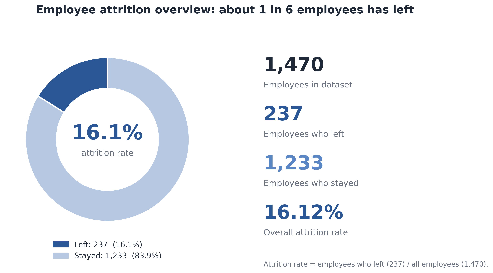
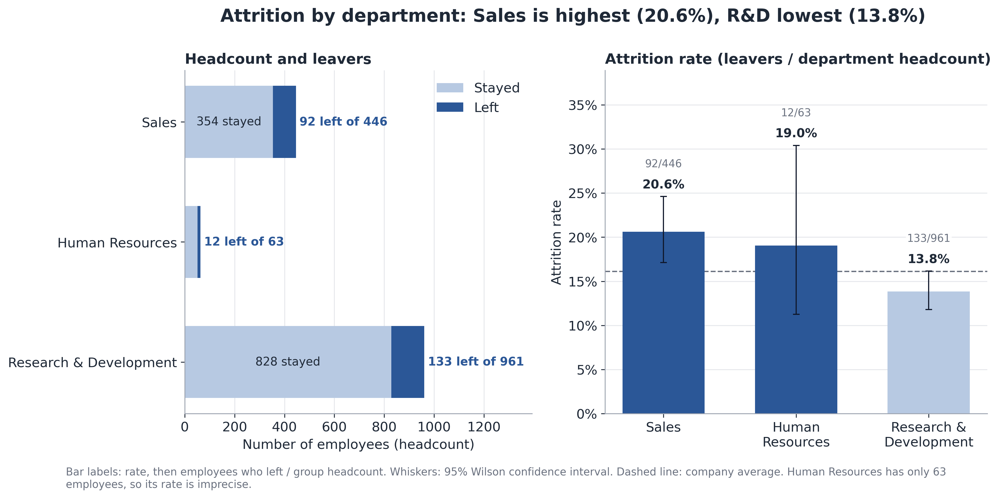
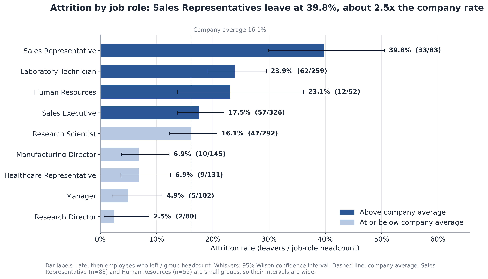
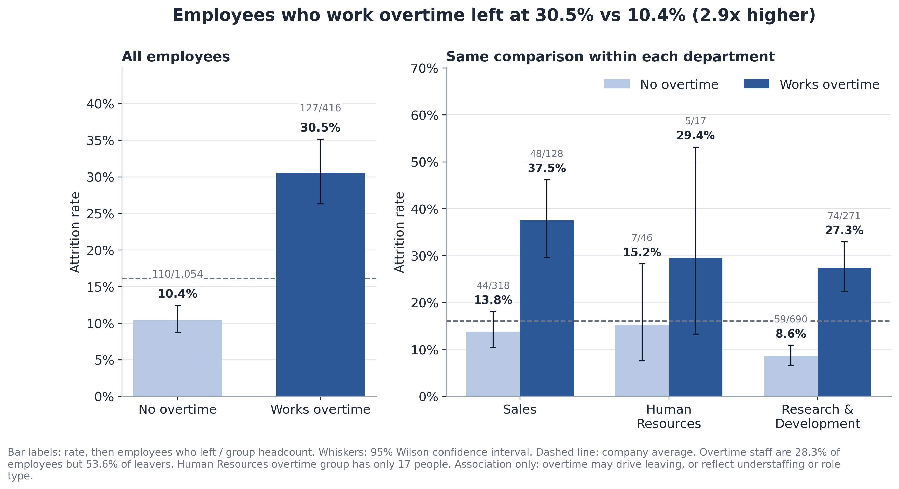
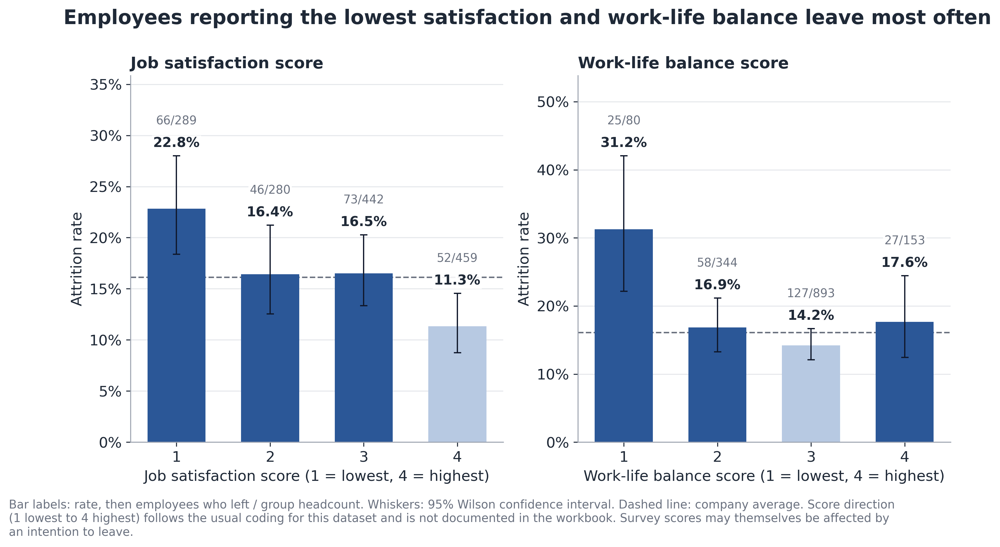
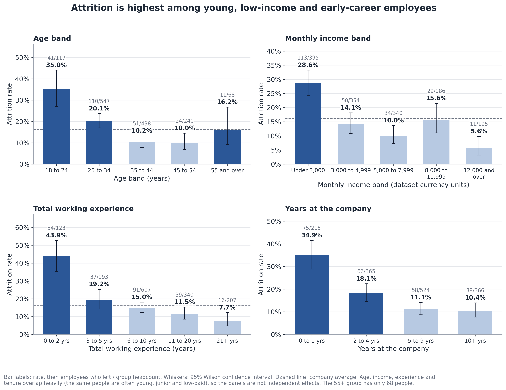

# Employee Attrition Analysis

A portfolio-ready **data cleaning and exploratory analysis** project focused on employee attrition using Python, Pandas, and data visualization.

> **Educational/training project.** The repository is designed to demonstrate a reproducible analysis workflow. It is not a predictive model and should not be used to make employment decisions about individuals.

## Business context and objectives

The HR team wants to understand which employee groups are associated with higher attrition and where retention efforts may be focused. This project:

- validates data quality and the private-source cleaning decisions;
- integrates the private employee reference sheet without publishing names or identifiers;
- measures overall attrition and compares departments, job roles, overtime, age bands, salary bands, experience, and tenure;
- communicates associations carefully, without treating them as proof of causation; and
- translates the strongest observed associations into practical, testable retention actions.

## Dataset and publication safety

The published analytical extract contains **1,470 rows** and 18 release-safe columns. It contains no employee names, employee numbers, direct IDs, exact ages, exact salary/rate values, dates, or original raw workbook. Age, salary, experience, and tenure are represented only as broad bands. The original workbook was used locally for validation and is intentionally excluded from GitHub.

The source workbook contained 1,474 raw rows and 1,470 distinct employee IDs. Private validation resolved four duplicate IDs and standardized department labels. Twenty-one age values were blank/placeholder values in both source sheets, so they were **not guessed or imputed** and are represented as `Unknown` in the release. Three constant columns were removed, and the private join was validated for IDs, names, departments, and available ages. The released data no longer contains those identifiers.

## Key verified findings

| Finding | Evidence from the released extract |
|---|---:|
| Overall attrition | 237 of 1,470 employees (16.1%) |
| Highest department rate | Sales: 20.6% |
| Highest job-role rate | Sales Representative: 39.8% |
| Overtime comparison | 30.5% with overtime vs 10.4% without |
| Early-career experience | 43.9% for 0–2 years of total experience |

The analysis suggests that overtime, early-career/low-experience groups, and a small number of job roles deserve attention. These are **associations in a one-time snapshot**, not causal conclusions.

## Data-cleaning workflow

1. Profile row counts, columns, missingness, duplicate IDs, and category values on the private workbook.
2. Resolve duplicate `EmployeeNumber` rows using the private employee reference sheet rather than whole-row or name matching.
3. Trim and standardize department variants.
4. Use an exact age from the private reference only when available; leave the 21 unresolved blank/placeholder ages as `Unknown` rather than inventing values.
5. Remove zero-variance technical columns (`EmployeeCount`, `Over18`, `StandardHours`).
6. Create broad analytical bands and remove direct identifiers before publication.
7. Run release-safety assertions: no identifier columns, no missing values, valid attrition flags, and expected dimensions.

## Exploratory analysis methodology

The notebook computes employee counts, leaver counts, and attrition rates as `leavers / employees` for each group. It uses grouped comparisons and six reproducible visualizations. No predictive model, causal inference, or individual-level recommendation is performed.

## Data Visualizations

The charts below summarize the main attrition patterns in the de-identified dataset. They show associations in a one-time snapshot and should not be interpreted as evidence that any individual factor causes attrition.

### 1. Overall employee attrition overview

This chart shows the overall split between employees who left and employees who stayed. In the dataset, 237 of 1,470 employees left, corresponding to a 16.1% attrition rate.



### 2. Attrition by department

Sales has the highest department attrition rate at 20.6%, followed by Human Resources at 19.0% and Research & Development at 13.8%. The chart also shows the headcount and leaver counts behind each rate.



### 3. Attrition by job role

Attrition varies considerably across job roles: Sales Representatives have the highest observed rate at 39.8%, while Research Directors have the lowest at 2.5%. Confidence intervals and group sizes are shown to provide context for these comparisons.



### 4. Attrition by overtime

Employees recorded as working overtime had a 30.5% attrition rate compared with 10.4% among employees without overtime. The department-level comparisons show the same direction in each department, but this remains an association rather than proof of causation.



### 5. Attrition by satisfaction and work-life balance

The chart compares attrition rates across job-satisfaction and work-life-balance scores. The lowest reported score groups have the highest observed rates in these comparisons, although the chart is descriptive and survey responses may overlap with other employee characteristics.



### 6. Attrition by age, income, and experience

Attrition is highest in the youngest age band, the lowest income band, the 0–2 years of total experience group, and the 0–1 years-at-company group. These variables overlap substantially, so the panels should not be read as independent effects; the 21 records with unknown age are excluded from the age-band comparison.



## Repository structure

```text
employee-attrition-analysis/
├── README.md
├── notebooks/
│   └── employee_attrition_analysis.ipynb
├── data/
│   ├── employee_attrition_deidentified.csv
│   └── DATA_SAFETY.md
├── Images/
│   ├── attrition_overview.png
│   ├── attrition_by_department.png
│   ├── attrition_by_job_role.png
│   ├── attrition_by_overtime.png
│   ├── attrition_by_satisfaction.png
│   └── attrition_by_age_income_experience.png
├── requirements.txt
└── .gitignore
```

## Installation and execution

```bash
git clone https://github.com/youmna24zaian/employee-attrition-analysis.git
cd employee-attrition-analysis
python -m venv .venv
# macOS/Linux: source .venv/bin/activate
# Windows PowerShell: .venv\Scripts\Activate.ps1
pip install -r requirements.txt
jupyter notebook notebooks/employee_attrition_analysis.ipynb
```

The notebook uses the relative path `../data/employee_attrition_deidentified.csv` and can be executed from the repository notebook directory or through Jupyter.

## Limitations and ethical considerations

- The data is a static snapshot and has no leaving dates, so it cannot show trends over time.
- Age, experience, tenure, salary, job level, and role are correlated or overlapping; separate group rates should not be interpreted as independent effects. Twenty-one records have unknown age and are excluded from age-band comparisons.
- Small groups can produce unstable rates. Review sample sizes before acting.
- Attrition associations do not establish cause. Test interventions with appropriate HR governance and monitor for unintended disparate impact.
- This release is de-identified for educational use, but no public data release can guarantee zero re-identification risk. Do not combine it with external employee records or use it for individual employment decisions.

## License / use

No license is asserted for the underlying source workbook. The repository contents are provided for educational portfolio review and reproducibility of the included analysis.
